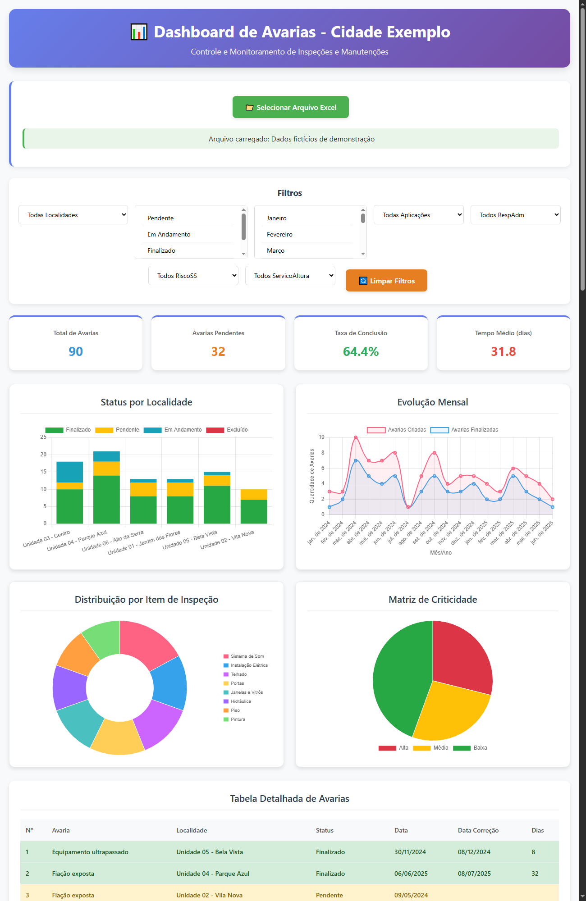
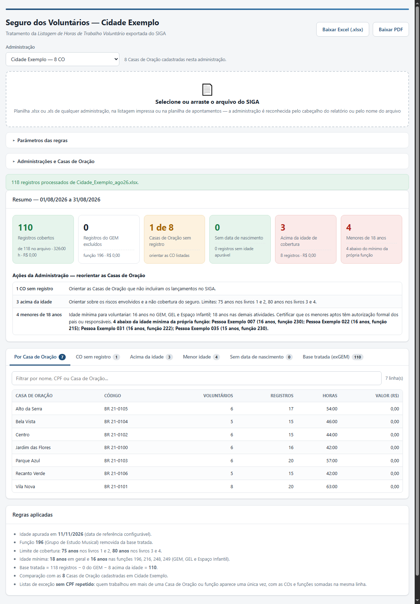

# Daniel Schincaglia Viviani

**Ver o portfólio interativo (filtros e busca): https://danielviviani.github.io/portfolio/**

**Tech Lead Full Stack & Inteligência Artificial** · São Paulo - SP
[LinkedIn](https://www.linkedin.com/in/danielviviani/) · contato.danielviviani@gmail.com

15 anos construindo software que opera de verdade: ERP sob medida para distribuição e varejo, CRM com WhatsApp, apps mobile, BI e agentes de IA integrados a sistemas reais. Uso IA onde ela agrega, código determinístico onde precisa de exatidão e aprovação humana onde há risco.

> Nomes de clientes e dados internos foram omitidos. O código de projetos de clientes é privado e pode ser demonstrado sob NDA.

## Destaques

| Projeto | O que é |
|---|---|
| **Agente de IA integrado a um ERP legado** | Agente dentro do ERP (Delphi) para cadastros e NF-e: proposta com a fonte de cada campo, aprovação humana, auditoria somente-inserção, ferramentas de escopo fechado e três níveis de autonomia. |
| **Hub de 19 agentes de trabalho** | Telegram + Claude Code, com agenda, aprovação por botão, teto de custo, 25 arquivos de teste e CI/CD. Só 4 dos 19 usam LLM. |
| **CRM multi-tenant com WhatsApp e IA** | Em produção: ~500 conversas/mês, 30+ clientes ativos. NestJS, Next.js, PostgreSQL, Redis, BullMQ; agente de enriquecimento de leads. |
| **Ecossistema para distribuidora de alimentos** | ERP Delphi (~480 unidades, 177 mil linhas) + API AdonisJS + apps React Native offline (vendas, entregas, separação) + painel web. Roteirização, canhoto eletrônico, NF-e/CT-e, boletos em ~20 bancos, acordos comerciais com indústrias. |
| **SGE: família de ERPs sob medida** | Mais de 10 implantações em segmentos como autopeças, materiais de construção, varejo, embalagens e papelaria. |

## Agentes e IA
- Agente de orçamento de projetos (IA estima horas e tokens; o preço é calculado por código)
- Análise de licitações do Brasil e de Portugal (IA só no detalhamento)
- Prospecção a frio com base da Receita Federal (nada sai sem aprovação)
- Servidor MCP de gestão financeira pessoal
- Ponte Telegram para o Claude Code
- Squads de agentes para conteúdo (OpenSquad)
- Memória compartilhada de equipe com ai-memory

## Web e SaaS
Integração de marketplaces (Mercado Livre) · SaaS de precificação para confeiteiras · SaaS de planejamento financeiro (FIRE) · Plataforma de cardápio e pedidos para restaurantes · Sites e landing pages · Catálogo de autopeças com extração de PDFs

## ERP e fiscal
Módulos fiscais reutilizáveis (NF-e, NFC-e, SAT, boleto, TEF) · Db2Sql (conversão de bases legadas) · Atualização de NCM, CFOP, CSOSN e ICMS · Utilitários em Python

## Mobile
Apps React Native/Expo (vendas, entregas, separação, BI mobile, consulta de CNPJs) · Layout em Figma de app para vendedor externo

## Dados e BI
Pentaho (DW, ETL, OLAP) · Power BI · ETL da base pública de CNPJ · Monitor de opções da B3 · Lançamento automático de notas de corretagem

## Pessoais e voluntariado

Dashboard de avarias e manutenções · Tratamento do relatório do seguro de voluntários · Vídeos educativos programáticos (React + Remotion) · Bot de pixel art · Baixador de vídeo/áudio

## Open source
ACBr e Lazarus/Free Pascal · T2Ti ERP · MoneyPrinterTurbo, PicoClaw, OpenSquad e whisper.cpp · NestJS, Next.js, AdonisJS, Prisma, Remotion, Evolution API, BullMQ, Socket.io, Pentaho

## Formação contínua em IA
- Formação Engenheiro de IA Generativa 2026: IA na Prática (Udemy, 103 horas, nov/2026)
- Introduction to Model Context Protocol (Anthropic, abr/2026) · [verificar certificado](https://verify.skilljar.com/c/yu9qjf6bfv55)

## Como eu trabalho
Especificação viva (SDD) antes do código · TDD com testes de segurança · CI/CD em estágios rápidos · regras por projeto em `CLAUDE.md` · auditoria e limite de custo nos agentes · memória compartilhada da equipe com ai-memory.
